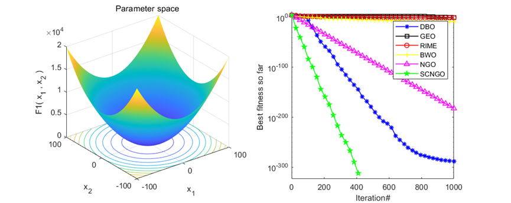
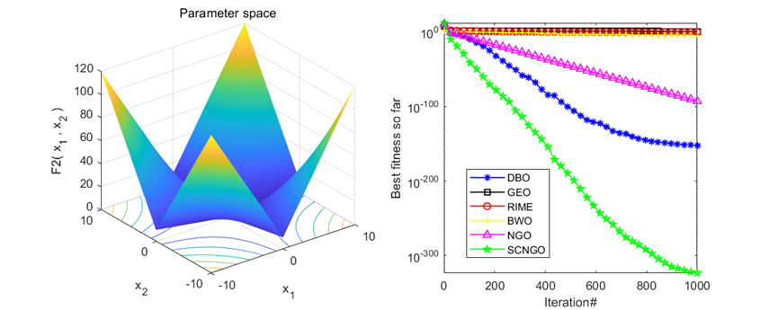
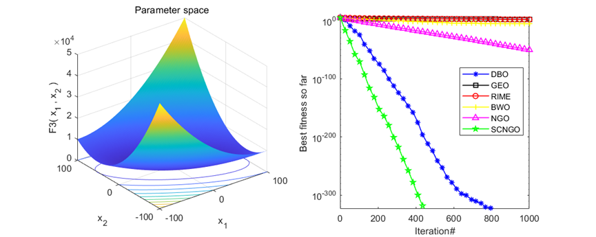
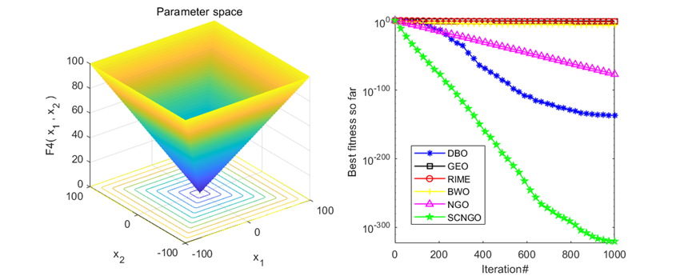
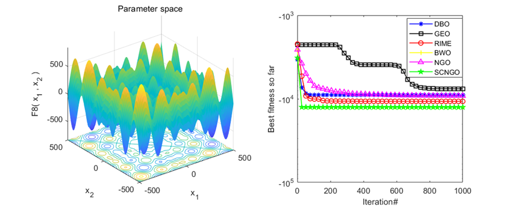
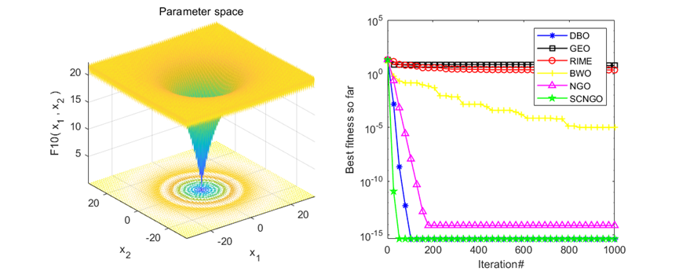

# Optimization Algorithm of Northern Eagle with Fusion of Cosine and Transmitted Backward Learning Compared with Golden Eagle/Dung Beetle/Whale/Frost Ice Algorithm

The improvement strategy refers to the previous improvement of the sparrow optimization algorithm, with the following improvements:
① Initialize the individual of Northern Eagle Algorithm using a refraction inverse learning strategy, which fundamentally involves computing the reverse solution of the current solution to expand the search range and thereby identify better alternative solutions for the given problem.
② Replace the original eagles algorithm's survey phase position update formula with a cosine strategy.
③ Improve the step size search factor of the cosine strategy; The original step size search factor shows a linear declining trend, which is not conducive to further balancing the global and local exploration capabilities of the Northern Eagle Algorithm.
Tested on the CEC2005 function set, the results are as follows: SCNGO is the improved algorithm proposed in this paper, DBO is the Dung Beetle optimization, GEO is the golden eagle optimization, RIME is the frost ice optimization algorithm, BWO is the white whale optimization algorithm, NGO is the northern hawk optimization.
Algorithm iteration 1000 times, each algorithm's particle number is set to 100.
Results Analysis: In the tests of single peak function and multi-peak function, it can be seen that the improved Northern Eagle Optimization Algorithm performs quite well.
Unimproved Northern Eagle (NGO) source code display:
%% \nfunction [Score,Best_pos,NGO_curve]=NGO(Search_Agents,Max_iterations,Lowerbound,Upperbound,dimensions,objective)\nLowerbound=ones(1,dimensions).*(Lowerbound);                              % Lower limit for variables\nUpperbound=ones(1,dimensions).*(Upperbound);                              % Upper limit for variables\nX=[];\nX_new=[];\nfit=[];\nfit_new=[];\nNGO_curve=zeros(1,Max_iterations);\nfor i=1:dimensions\n    X(:,i) = Lowerbound(i)+rand(Search_Agents,1).*(Upperbound(i) -Lowerbound(i));              % Initial population\nend\nfor i =1:Search_Agents\n    L=X(i,:);\n    fit(i)=objective(L);                    % Fitness evaluation (Explained at the top of the page. )\nend\nfor t=1:Max_iterations  % algorithm iteration   \n    %%  update: BEST proposed solution\n    [best , blocation]=min(fit);\n    if t==1\n        xbest=X(blocation,:);                                           % Optimal location\n        fbest=best;                                           % The optimization objective function\n    elseif best<fbest\n        fbest=best;\n        xbest=X(blocation,:);\n    end\n    %% UPDATE Northern goshawks based on PHASE1 and PHASE2\n    for i=1:Search_Agents\n        %% Phase 1: Exploration\n        I=round(1+rand);\n        k=randperm(Search_Agents,1);\n        P=X(k,:); % Eq. (3)\n        F_P=fit(k);\n        if fit(i)> F_P\n            X_new(i,:)=X(i,:)+rand(1,dimensions) .* (P-I.*X(i,:)); % Eq. (4)\n        else\n            X_new(i,:)=X(i,:)+rand(1,dimensions) .* (X(i,:)-P); % Eq. (4)\n        end\n        X_new(i,:) = max(X_new(i,:),Lowerbound);X_new(i,:) = min(X_new(i,:),Upperbound);\n        % update position based on Eq (5)\n        L=X_new(i,:);\n        fit_new(i)=objective(L);\n        if(fit_new(i)<fit(i))\n            X(i,:) = X_new(i,:);\n            fit(i) = fit_new(i);\n        end\n        %% END PHASE 1\n        %% PHASE 2 Exploitation\n        R=0.02*(1-t/Max_iterations);% Eq.(6)\n        X_new(i,:)= X(i,:)+ (-R+2*R*rand(1,dimensions)).*X(i,:);% Eq.(7)\n        \n        X_new(i,:) = max(X_new(i,:),Lowerbound);X_new(i,:) = min(X_new(i,:),Upperbound);\n        \n        % update position based on Eq (8)\n        L=X_new(i,:);\n        fit_new(i)=objective(L);\n        if(fit_new(i)<fit(i))\n            X(i,:) = X_new(i,:);\n            fit(i) = fit_new(i);\n        end\n        %% END PHASE 2\n    end% end for i=1:N\n    %%\n    %% SAVE BEST SCORE\n    best_so_far(t)=fbest; % save best solution so far\n    average(t) = mean (fit);\n    Score=fbest;\n    Best_pos=xbest;\n    NGO_curve(t)=Score;\nend\nend\n  
Br
1. Product Technical Requirements

## Images

<!-- PAYMENT_BLOCK -->

## Get this dataset

- Payment link (Stripe): [Buy now](https://buy.stripe.com/3cs8yP7sY87d0vu9AB)
- Payment QR code: 

<!-- /PAYMENT_BLOCK -->
